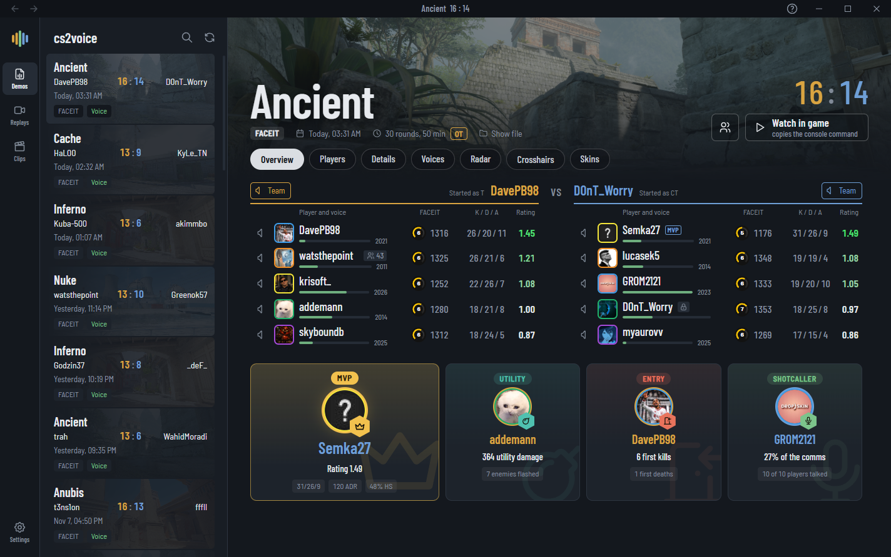
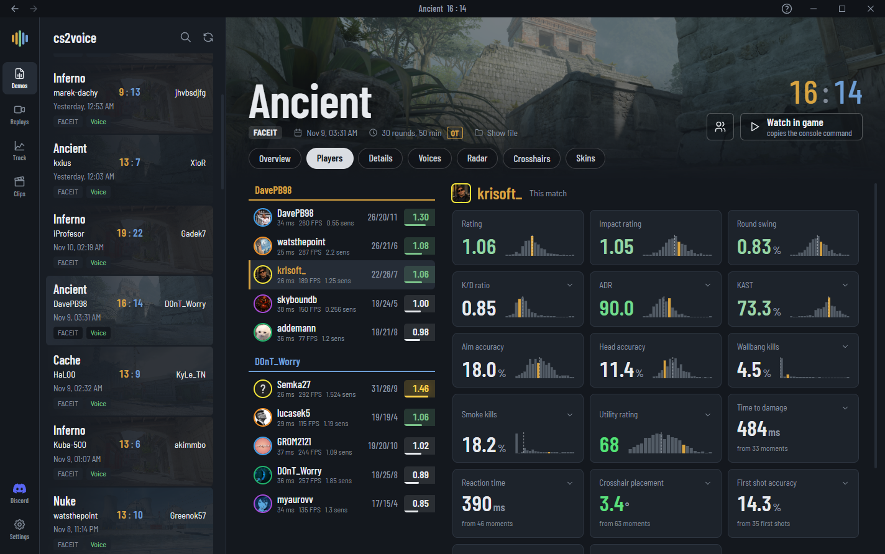
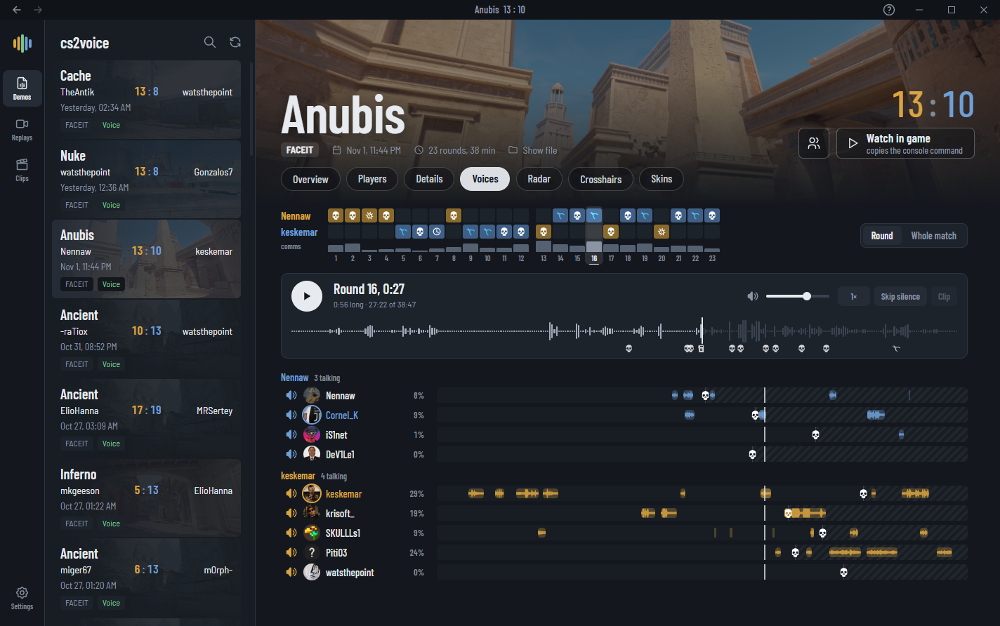
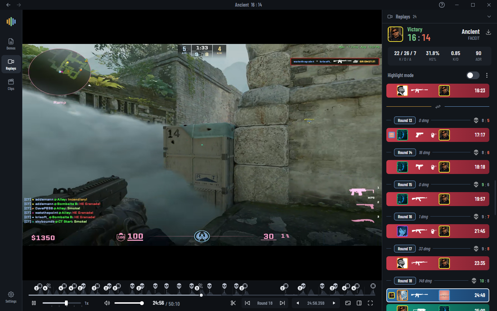
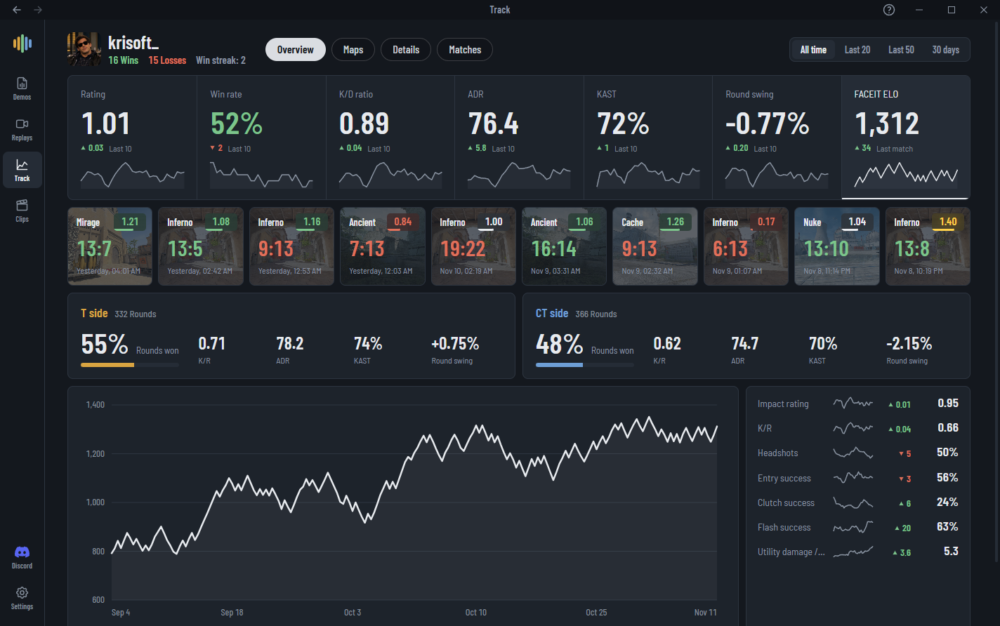
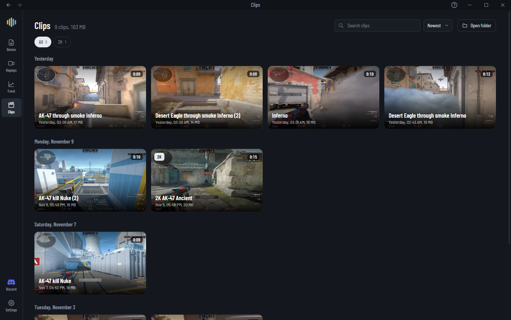

# cs2voice

A Windows app for CS2 demos. Play each player's voice chat, go through the match, and follow your own stats from one demo to the next.

Website: https://krisoft20.github.io/cs2voice/ · Discord: https://discord.gg/4vsvva5GHM

## Download

<a href="https://apps.microsoft.com/detail/9pdv2hrck9ws?mode=direct"></a>

From the Microsoft Store it installs like any other app and the Store keeps it updated.

Or get `cs2voice.exe` from the [latest release](https://github.com/krisoft20/cs2voice/releases/latest). It is a single file, with no installer. Put it anywhere and run it. The exe is not code signed, so Windows SmartScreen may warn the first time. Click "More info", then "Run anyway". This version checks GitHub for a new version on start and offers to update itself. You can turn that off in Settings.

### Only from here

cs2voice is free and only comes from this repo and its [Microsoft Store page](https://apps.microsoft.com/detail/9pdv2hrck9ws). Anything else is fake, [report it](https://github.com/krisoft20/cs2voice/issues).

cs2voice.com is a different, paid web service and has nothing to do with this app.

## Requirements

- Windows 10 or 11, 64-bit
- Microsoft Edge WebView2 Runtime. Windows 11 already has it. If it is missing, cs2voice offers to install it.
- CS2, for the map images, icons and skins, and to watch a demo in game

## Demos

Finds `.dem` and `.dem.zst` files from FACEIT and matchmaking in the CS2 replays folder, Downloads and any folder you add.

### Overview

Both teams with ratings, match awards, and "Watch in game", which copies the console command that plays the demo with only the voices you picked.



### Players

Every stat drawn against how players usually score. Click one to see the moments behind it.



### Voices

Every player's voice, round by round, next to the kills. Play everyone, one team or one player, skip silence, cut a clip.



The match view also has Details (rounds, kill feed, damage), a 2D Radar replay, Crosshairs and Skins.

## Replays

Steam's background recording of your match, lined up with the demo's rounds and kills.



## Track

Your own numbers across every demo: rating, win rate, T and CT side, maps, clutches, weapons and FACEIT ELO.



## Clips

Cut a moment into an MP4 small enough for Discord.



## Privacy

Everything is read from the demo files on your PC. Nothing is uploaded. cs2voice goes online only to:

- check GitHub for a new version (can be turned off)
- read the public Steam profiles of the players in your demos, for avatars and account age
- read FACEIT for the level and ELO of players in your FACEIT demos, and for your own ELO history (the same switch in Settings turns off both this and the Steam lookups)
- download the WebView2 Runtime, if it is missing and you agree

Its own data (caches, settings, log) is in `%LOCALAPPDATA%\cs2voice`.

One file, `gamestate_integration_cs2voice.cfg`, is added to the CS2 `cfg` folder. With it CS2 sends the state of your match to the app on your own PC (127.0.0.1), so background work can pause while you play. This is Valve's game state integration. Nothing leaves your computer.

## Building

You need Visual Studio 2022 or newer with the C++ desktop workload, and Node.js.

```
build.cmd ui
build.cmd release
```

The exe is `build\release\bin\Release\cs2voice.exe`. `build.cmd dist` puts it with its SHA-256 in `dist\`. `build.cmd vs` makes a Visual Studio solution.

The demo parser, the zstd decoder (`core/parser/demo/zstdx.cpp`) and the readers for the game's files and map geometry are written for this project. Voice is Opus, decoded by WebView2. The only outside code is the WebView2 SDK in `third_party/webview2`.

## Contributing

Issues and pull requests are welcome. For bugs, attach `%LOCALAPPDATA%\cs2voice\cs2voice.log`. New translations go in `ui/src/lang/`, one file per language.

## License

Copyright (c) 2026 krisoft20. GPL-3.0, see [LICENSE](LICENSE). You can use, change and share the code, but anything you release that is built on it has to be GPL-3.0 with its source available too.

The zstd decoder (`core/parser/demo/zstdx.cpp` and `zstdx.h`) is MIT, as written at the top of both files. The WebView2 SDK has its own license in `third_party/webview2/LICENSE.txt`.

cs2voice is not affiliated with Valve or FACEIT.
