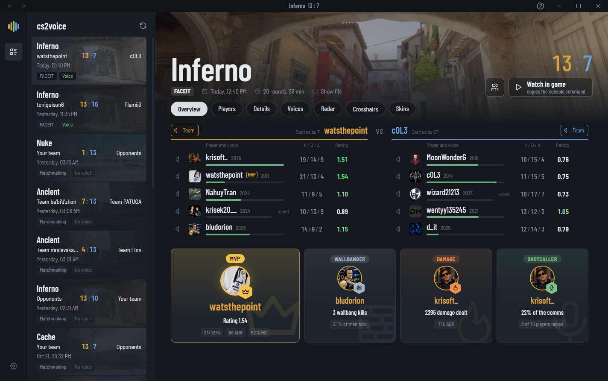
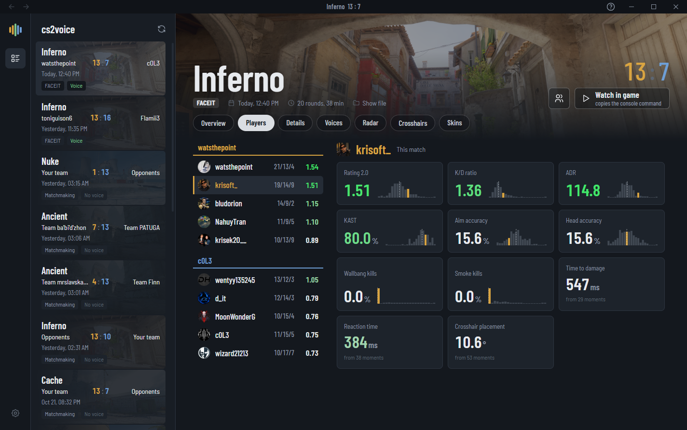
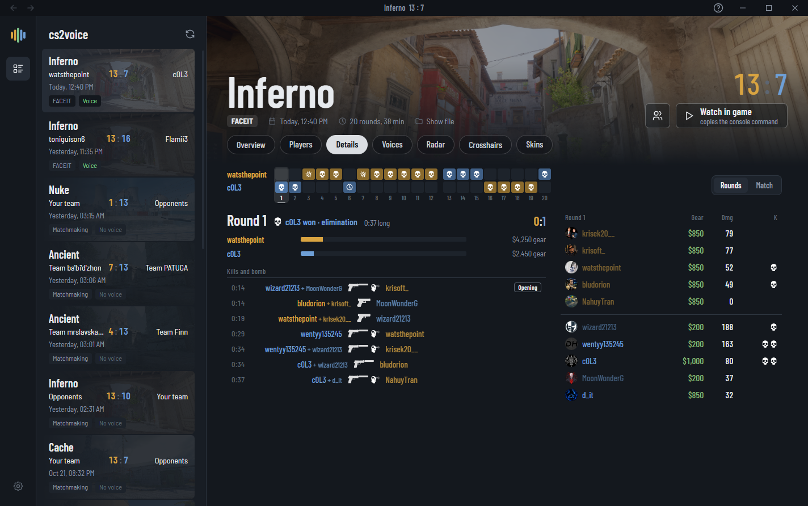
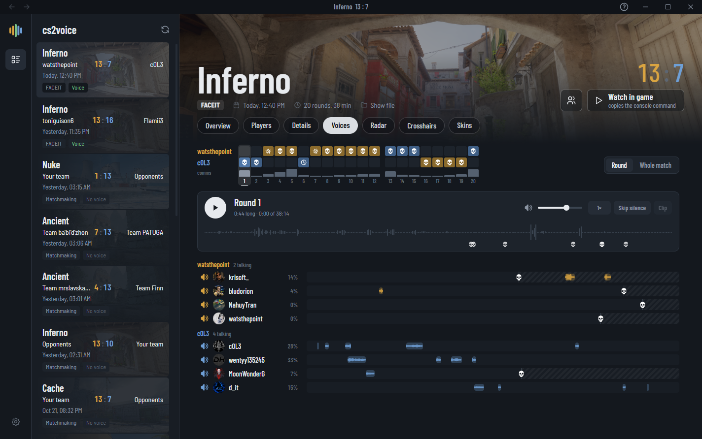
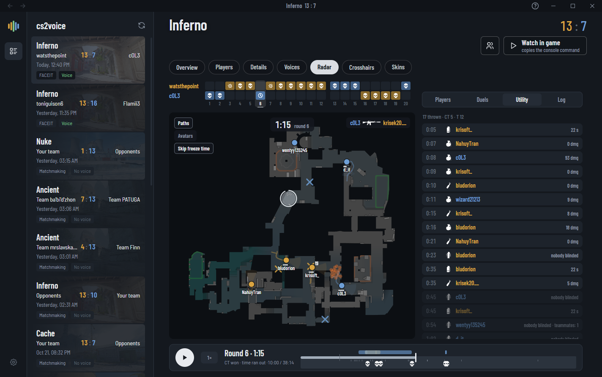
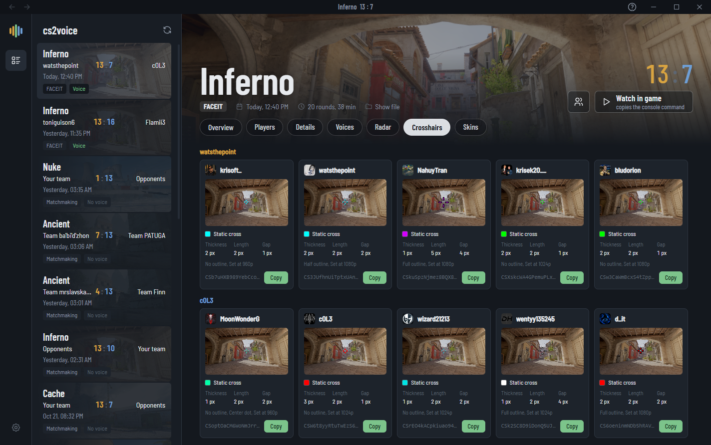
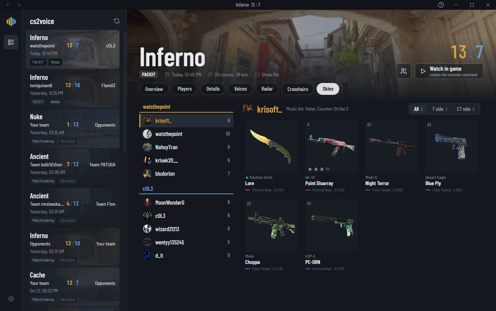

# cs2voice

A Windows app for Counter-Strike 2 demos. It finds the demos on your PC, plays each player's voice chat, and shows the match: stats, rounds, a 2D radar replay, crosshairs and skins.

## Download

Get `cs2voice.exe` from the [latest release](https://github.com/krisoft20/cs2voice/releases/latest). It is a single file, with no installer. Put it anywhere and run it.

The exe is not code signed, so Windows SmartScreen may warn the first time. Click "More info", then "Run anyway".

cs2voice checks GitHub for a new version on start and offers to update itself. You can turn that off in Settings.

### Only from here

cs2voice is free and only comes from this repo. Anything else is fake, [report it](https://github.com/krisoft20/cs2voice/issues).

## Requirements

- Windows 10 or 11, 64-bit
- Microsoft Edge WebView2 Runtime. Windows 11 already has it. If it is missing, cs2voice offers to install it.
- CS2, for the map images, icons and skins, and to watch a demo in game

## Demos

cs2voice lists demos from the CS2 replays folder, Downloads and any folders you add, in `.dem` and `.dem.zst`, from FACEIT and matchmaking. Each one shows the map, score, teams, date and whether it has voice.

Cleanup finds old demos you have not opened, second copies of the same match and unreadable files, and moves them to the Recycle Bin or deletes them for good. It can ask first or run on its own.

## Tabs

### Overview

Both teams with K/D/A, rating and Steam account year, a button to hear one player or one team, and the match awards. "Watch in game" copies the console command that plays the demo with only the voices you picked.



### Players

Rating, K/D, ADR, KAST, accuracy, head accuracy, wallbang and smoke kills, time to damage, reaction time and crosshair placement. Each stat is drawn against how players usually score.



### Details

How each round ended, the kill feed with the game's icons, gear and damage per round, and a match table.



### Voices

One round at a time. Each player has a lane with their speech drawn by loudness, with kills, deaths and the bomb marked. Play everyone, one team or one player, skip silence, change the speed and cut a clip.



### Radar

A 2D replay of the match: positions, view directions, grenades with their flight paths, smokes, fires, the bomb, damage and kills. Click a grenade to see where it was thrown from, how it was thrown (jumpthrow, run, crouch) and a `setpos`/`setang` line to copy.



### Crosshairs

Every player's crosshair drawn at game size, with its settings and a copy button for the share code.



### Skins

Every player's skins with wear, float, StatTrak and stickers, split by T and CT side. Click one to see it large.



## Privacy

Everything is read from the demo files on your PC. Nothing is uploaded. cs2voice goes online only to:

- check GitHub for a new version (can be turned off)
- read the public Steam profiles of the players in your demos, for avatars and account age
- download the WebView2 Runtime, if it is missing and you agree

Its own data (caches, settings, log) is in `%LOCALAPPDATA%\cs2voice`.

## Building

You need Visual Studio 2022 or newer with the C++ desktop workload, and Node.js.

```
build.cmd ui
build.cmd release
```

The exe is `build\release\bin\Release\cs2voice.exe`. `build.cmd dist` puts it with its SHA-256 in `dist\`. `build.cmd vs` makes a Visual Studio solution.

The demo parser, the zstd decoder (`core/parser/demo/zstdx.cpp`) and the readers for the game's files and map geometry are written for this project. Voice is Opus, decoded by WebView2. The only outside code is the WebView2 SDK in `third_party/webview2`.

## Contributing

Issues and pull requests are welcome. For bugs, attach `%LOCALAPPDATA%\cs2voice\cs2voice.log`. New translations go in `ui/src/i18n.ts`.

## License

Copyright (c) 2026 krisoft20. GPL-3.0, see [LICENSE](LICENSE). You can use, change and share the code, but anything you release that is built on it has to be GPL-3.0 with its source available too.

The zstd decoder (`core/parser/demo/zstdx.cpp` and `zstdx.h`) is MIT, as written at the top of both files. The WebView2 SDK has its own license in `third_party/webview2/LICENSE.txt`.

cs2voice is not affiliated with Valve or FACEIT.
